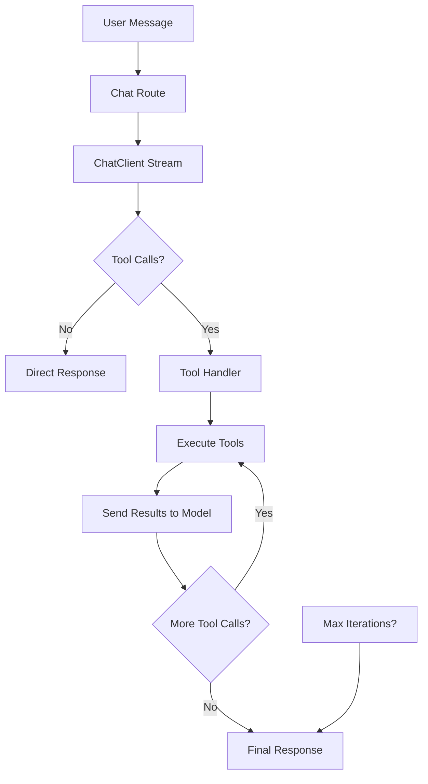

# MCP Open Client - Architecture Documentation

## 🏗️ System Architecture Overview

The MCP Open Client is built with a modular architecture that separates concerns and makes the system maintainable and extensible.

## 📁 Project Structure

```
mcp_open_client/
├── server/
│   ├── routes/
│   │   ├── chat.py          # Clean chat API endpoints
│   │   ├── config.py        # Configuration management
│   │   └── ui.py           # Frontend serving
│   └── models.py           # Pydantic data models
├── services/
│   ├── chat_client.py      # LLM provider interface
│   ├── tool_call_handler.py # Tool execution & recursive loops
│   ├── tool_simulator.py   # Built-in tool implementations
│   └── default_tools.py    # Default tool definitions
├── config/
│   └── __init__.py         # Configuration management
└── ui/                     # React frontend
    └── components/         # UI components
```

## 🔧 Core Components

### **1. Chat Routes (`server/routes/chat.py`)** ✅ **REFACTORIZADO**

**Purpose**: Clean API endpoints for chat completions
**Size**: ~200 lines (down from 400+ lines)

**Key Functions**:
- `chat_completions()` - Non-streaming chat endpoint
- `stream_chat_completions()` - Streaming chat with tool support

**Responsibilities**:
- Request validation with Pydantic models
- Message format conversion (ChatMessage → dict)
- Configuration management (provider_id, model, api_key)
- Initial streaming setup and coordination
- **Delegación completa a ToolCallHandler**

**Key Improvements**:
- ✅ Separación de responsabilidades
- ✅ Código más limpio y mantenible
- ✅ Eliminación de lógica de tool calls duplicada
- ✅ Configuración centralizada

### **2. Tool Call Handler (`services/tool_call_handler.py`)** ✅ **REFACTORIZADO**

**Purpose**: Manages tool execution and recursive followup loops
**Size**: ~200 lines (completamente nuevo)

**Key Features**:
- **Recursive tool calling**: Handles multiple rounds of tool execution automatically
- **Loop prevention**: Maximum iteration limit (default: 5, configurable)
- **Error handling**: Graceful failure recovery with detailed logging
- **Event streaming**: Real-time progress updates via SSE
- **Configuration flexible**: Acepta provider_id, model, api_key
- **Separación completa**: Toda la lógica de tool calls aislada

**Core Method** (ACTUALIZADA):
```python
async def execute_tool_calls_with_followup(
    self,
    active_tool_calls: Dict[str, Any],
    messages: List[Dict[str, Any]],
    provider_id: str,  # ✅ NUEVO
    model: str,        # ✅ NUEVO
    api_key: str,      # ✅ NUEVO
    temperature: float = 0.7,
    max_tokens: Optional[int] = None
) -> AsyncGenerator[str, None]
```

**Workflow Detallado**:
1. Execute initial tool calls via ToolSimulator
2. Yield tool execution events (start, complete, error)
3. Construct conversation history with tool results
4. Send results to model via ChatClient ✅ **NUEVO**
5. If model returns more tool calls → repeat
6. Continue until no more tool calls or max iterations
7. Return final response with accumulated content/reasoning

**Internal Methods**:
- `_execute_tools()` - Batch tool execution with error handling
- `_yield_tool_events()` - SSE event formatting for frontend

### **3. Default Tools (`services/default_tools.py`)**

**Purpose**: Configuration of built-in tools
**Size**: ~60 lines

**Available Tools**:
- `calculate` - Mathematical expressions
- `get_current_time` - Time/date information
- `search_web` - Web search (simulated)
- `get_weather` - Weather data (simulated)

### **4. Tool Simulator (`services/tool_simulator.py`)**

**Purpose**: Implementation of simulated tools
**Existing**: Already implemented, no changes needed

## 🔄 Tool Call Flow

### **Complete Workflow**:



### **Event Types**:

| Event | Description | When |
|-------|-------------|------|
| `reasoning_chunk` | Model reasoning | During thinking |
| `content_chunk` | Response content | During generation |
| `tool_call_start` | Tool execution begins | Before tool runs |
| `tool_execution_start` | Tool actually running | During execution |
| `tool_execution_complete` | Tool finished successfully | After success |
| `tool_execution_error` | Tool failed | After error |
| `tool_followup_start` | Model processing results | Before followup |
| `tool_followup_complete` | All iterations done | End of loop |
| `complete` | Final completion | End of response |

## 🛡️ Safety Features

### **Loop Prevention**:
- **Maximum iterations**: Default 5, configurable
- **Timeout handling**: Each tool has execution timeout
- **Error recovery**: Graceful handling of tool failures

### **Resource Management**:
- **Connection pooling**: Reuse HTTP connections
- **Memory efficiency**: Streaming responses
- **Error boundaries**: Isolated tool execution

## 🎯 Benefits of Refactoring

### **Before Refactoring**:
- ❌ Single 400+ line file
- ❌ Mixed concerns (routing + tool logic)
- ❌ No recursive tool calling
- ❌ Hard to test and maintain
- ❌ Tool call duplication bugs

### **After Refactoring**:
- ✅ Modular architecture (4 focused modules)
- ✅ Clean separation of concerns
- ✅ Full recursive tool calling support
- ✅ Testable components
- ✅ Maintainable codebase
- ✅ Fixed duplication issues

## 🧪 Testing

### **Unit Tests Needed**:
- `ToolCallHandler` - Tool execution logic
- `DefaultTools` - Tool definitions
- Chat routes - API endpoints

### **Integration Tests**:
- Full tool call workflows
- Recursive calling scenarios
- Error handling paths

## 🚀 Future Extensions

### **Easy to Add**:
- New tool implementations
- Custom tool configurations
- Different LLM providers
- Advanced tool routing
- Tool call analytics

### **Recommended Next Steps**:
1. Add proper logging configuration
2. Implement tool call metrics
3. Add tool call caching
4. Create tool marketplace
5. Add tool permissions system